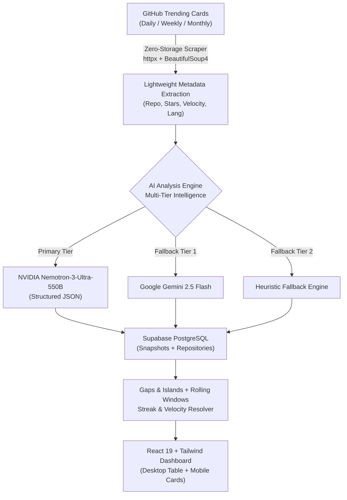

# GitHub Trend Tracker V2 🚀

[](https://github.com/Cyber-Arghya/github-trend-tracker-v2/actions)
[](LICENSE)
[](https://python.org)
[](https://vite.dev)
[](https://tailwindcss.com)
[](https://supabase.com)
[](https://build.nvidia.com)
[](https://vercel.com)

An autonomous, zero-storage GitHub Trending intelligence platform that captures daily, weekly, and monthly trending repositories, analyzes relational trajectory metrics in PostgreSQL, extracts structured architectural intelligence using **NVIDIA Nemotron-3-Ultra-550B** (with **Gemini 2.5 Flash** fallback), and surfaces an **All-Time Golden Trend Power Leaderboard** with a fully mobile-responsive React 19 dashboard.

🌐 **Live Production Dashboard:** [https://github-trend-tracker-v2.vercel.app](https://github-trend-tracker-v2.vercel.app)

---

## 💡 Why This Project Exists & How It Works

### The "Why" (The Problem & Vision)
1. **GitHub Trending is Ephemeral:** Standard GitHub Trending is a temporary snapshot. A repository that goes viral today disappears in 24 hours, erasing its historical momentum and trajectory.
2. **Raw Stars are Misleading:** A legacy repository with 100,000 stars growing at 5 stars/day is completely different from a new breakout project gaining 2,500 stars/day. Standard metrics fail to reflect viral momentum.
3. **Heavy Clones Waste Bandwidth & Disk:** Traditional crawlers clone gigabytes of git history and multi-megabyte READMEs just to extract what a project does.
4. **Foreign Language Barriers:** High-growth repositories often feature non-English descriptions (e.g. Chinese, Russian, Japanese), requiring manual translation to evaluate.
5. **Lack of VC / Breakout Radar:** Developers, open-source contributors, and technology investors need an automated signal radar that flags viral breakout repos, tracks active streaks, and summarizes technical architecture in seconds.

### The "How" (Architecture & Workflow)



1. **Phase 1: Zero-Storage Scraper (< 2s Ingestion):**
   - Automatically crawls GitHub Trending feeds for all languages and time horizons.
   - Extracts repository metadata, star delta, language, and primary description in memory without cloning or disk I/O.
2. **Phase 2: Multi-Tier Architectural Intelligence:**
   - Evaluates each repository using **NVIDIA Nemotron-3-Ultra-550B** (`nvidia/nemotron-3-ultra-550b-a55b`).
   - If NVIDIA rate limits or fails, falls back gracefully to **Google Gemini 2.5 Flash**, followed by deterministic offline heuristics.
   - Synthesizes non-English descriptions into English, extracts architecture category (`CLI Tool`, `AI/ML Framework`, `Library/SDK`), tech stack pills, production readiness score (1-100), and quick-start command.
3. **Phase 3: Relational History & Mathematical Power Scoring:**
   - Persists point-in-time snapshots to PostgreSQL on Supabase.
   - Computes rolling 7-day hotness, 30-day endurance, and consecutive day streaks using the SQL Gaps-and-Islands algorithm.
   - Ranks repositories using the **Golden Trend Power Score Formula**.
4. **Phase 4: Responsive Frontend Delivery:**
   - Serves an ultra-fast, zero-lag React 19 dashboard deployed on Vercel edge network.
   - Dynamically adapts between a multi-column desktop table and a custom touch-optimized mobile card view.

---

## 🌟 Comprehensive Feature Catalog

### 1. 🏆 All-Time Golden Trend Power Leaderboard
- Real-time ranking across all tracked repositories using a mathematically-sound, sub-linear velocity momentum formula.
- Viral repositories with breakthrough daily velocity (+2,000 stars/day) immediately rank at the top, without being overshadowed by old inactive projects.
- Visual progress bar and dynamic score coloring (Bright Emerald for breakout momentum, Amber for steady growth).

### 2. ⏱️ Historical Time Travel Date Selector
- Time period filtering: **All-Time**, **Today (Daily)**, **This Week**, and **This Month**.
- Calendar dropdown lets users time-travel to past snapshot dates (e.g. `2026-11-07`, `2026-11-06`).
- Automatic tie-breaking and guaranteed unique sequential ranks (`#1`, `#2`, `#3`... with zero rank collisions).

### 3. ⚡ Star Velocity & Breakout Radar
- Displays true 24-hour daily star acquisition rate (e.g. `+2,173/day`).
- **Breakout Badge (🔥):** Automatically highlights projects gaining over 1,000 stars/day.
- **Surge Badge (⚡):** Automatically highlights fast-moving projects gaining over 500 stars/day.

### 4. 🧠 AI Intelligence & Architecture Specs Drawer
- Click any repository row or mobile card to open the framed AI Specs Drawer.
- **Top Header Ribbon:** Prominent gradient banner with sparkles icon, repository name, category badge, license risk, and collapse button.
- **Value Proposition:** Concise English summary of the technical problem solved.
- **Tech Stack Pills:** Key frameworks and libraries detected.
- **Trending Presence Metrics:** 7-day hotness ratio, 30-day endurance ratio, active consecutive streak, and 30-day peak streak.
- **Quick-Start Command:** One-click copyable shell command (`npm install`, `cargo install`, `docker run...`).

### 5. ❤️ Personal Favorites System
- **Row-Hover Heart Button:** Hover over any repository on desktop (or tap on mobile) to toggle favorites.
- **Persistent LocalStorage:** Saved favorites survive page reloads and browser restarts.
- **Category Favorites Filter Pill:** Filter by favorites within the current category (`Category: [All] [❤️ Favorites (N)] ...`).
- **Top Bar Quick Filter:** Dedicated Favorites pill with live counter in the top filter bar.

### 6. 📱 Full Mobile & Tablet Responsiveness
- **Dedicated Mobile Card View (`< 640px`):** High-density cards displaying rank, name, stars, velocity flame, trend power bar, readiness badge, and favorite toggle without horizontal squishing.
- **Matrix-Optimized Desktop/Tablet Table (`sm`/`md`/`lg`):** Smooth column scaling adhering to the breakpoint visibility matrix.

### 7. 🕒 Live Crawler Status Indicator
- Displays exact UTC timestamp and relative time of the latest crawler run (e.g. `Last updated: Nov 8, 03:23 UTC (4h ago)`).

### 8. 🔍 Instant Search & URL Auto-Resolution
- Real-time search across repository names, descriptions, value propositions, and tech stacks.
- Paste full GitHub URLs (e.g. `https://github.com/vercel-labs/agent-desktop`) and the search bar automatically parses and finds the target repository.

---

## 📁 Project Architecture & File Map

```
github-trend-tracker-v2/
├── .github/
│   └── workflows/
│       └── automate.yml             # Cron workflow running scraper every 4 hours (6x daily)
├── scraper/
│   ├── analyzer.py                  # Multi-tier AI engine (NVIDIA Nemotron 550B -> Gemini -> Heuristics)
│   ├── collector.py                 # In-memory zero-storage GitHub Trending HTML parser
│   ├── database.py                  # Supabase PostgreSQL client & upsert operations
│   ├── main.py                      # Scraper CLI entrypoint (--period all|daily|weekly|monthly)
│   └── models.py                    # Pydantic schemas for repositories, snapshots, and AI specs
├── supabase/
│   └── migrations/                  # PostgreSQL schema definitions, indexes, and materialized views
├── dashboard/
│   ├── index.html                   # Single Page Application root with Tailwind configuration
│   ├── package.json                 # React 19, Vite, Lucide-React, Vitest dependencies
│   ├── scripts/
│   │   └── browser-verify.js        # Automated Puppeteer headless test suite (Desktop + Mobile)
│   └── src/
│       ├── App.tsx                  # Main data orchestrator & Supabase subscriber
│       ├── types/
│       │   └── index.ts             # TypeScript interfaces (UnifiedRepoItem, TrendingSnapshotItem, etc.)
│       ├── lib/
│       │   ├── supabase.ts          # Public Supabase client with safe anon fallback
│       │   ├── tableStyles.ts       # Shared badge styling, score color scales, and rank medals
│       │   ├── tableStyles.test.ts  # Unit tests for table styles & streak badge formats
│       │   ├── timeTravelResolver.ts      # Golden Trend Power calculator & historical snapshot resolver
│       │   └── timeTravelResolver.test.ts # Vitest suite for time travel & scoring logic
│       ├── hooks/
│       │   └── useRepoFilters.ts    # Centralized state hook (search, sort, categories, counts)
│       └── components/
│           ├── Header.tsx           # Mobile-responsive navbar with live counters & refresh trigger
│           ├── HistoricalDateSelector.tsx # Calendar snapshot date selector dropdown
│           ├── UnifiedTableView.tsx # Master container switching between desktop table & mobile cards
│           └── table/
│               ├── TableFilters.tsx     # Responsive multi-row filter bar (Time, Date, Category, Language)
│               ├── TableHeader.tsx      # Desktop sortable table header with responsive column hiding
│               ├── RepoTableRow.tsx     # Desktop table row with breakpoint visibility classes
│               ├── RepoMobileCard.tsx   # Mobile-optimized high-density card layout (< 640px)
│               ├── RepoExpandedCard.tsx # Shared AI Specs drawer (Value Prop, Tech Stack, Command)
│               └── TableEmptyState.tsx  # Context-aware empty state (Loading, No Matches, Empty Favs)
└── README.md
```

---

## 📊 Responsive Breakpoint Matrix

The frontend table and cards adapt across screen sizes:

| Column / Element | Mobile (`< 640px`) | Tablet (`sm: 640px`) | Tablet (`md: 768px`) | Desktop (`lg: 1024px+`) |
| :--- | :---: | :---: | :---: | :---: |
| **Rank Badge** | Visible (`table-cell`) | Visible | Visible | Visible |
| **Repository Name** | Visible (`table-cell`) | Visible | Visible | Visible |
| **Favorite Button** | Visible (`table-cell`) | Visible | Visible | Visible |
| **Total Stars** | Visible (`table-cell`) | Visible | Visible | Visible |
| **Production Readiness** | Hidden | Visible (`sm:table-cell`) | Visible | Visible |
| **Trend Power Score** | Hidden | Hidden | Visible (`md:table-cell`) | Visible |
| **24h Star Velocity** | Hidden | Hidden | Visible (`md:table-cell`) | Visible |
| **Peak Rank** | Hidden | Hidden | Hidden | Visible (`lg:table-cell`) |
| **Streak / 7d Presence** | Hidden | Hidden | Hidden | Visible (`lg:table-cell`) |
| **Language Tag** | Hidden | Hidden | Hidden | Visible (`lg:table-cell`) |
| **Architecture Category**| Hidden | Hidden | Hidden | Visible (`lg:table-cell`) |
| **GitHub External Link** | Visible (`table-cell`) | Visible | Visible | Visible |
| **Mobile Card Switch** | **Active (`RepoMobileCard`)** | Hidden (`hidden`) | Hidden (`hidden`) | Hidden (`hidden`) |

---

## 📐 Mathematical Formulation

### The Golden Trend Power Score Formula
The platform computes a dynamic score $S \in [20, 180+]$ for every repository:

$$S = \underbrace{120 \cdot \left(\frac{\min(2500, \text{Velocity})}{2500}\right)^{0.6}}_{\text{Normalized Velocity Momentum}} + \underbrace{25 \cdot \left(\frac{\text{Days}_{7\text{d}}}{7}\right)}_{\text{7-Day Hotness}} + \underbrace{15 \cdot \left(\frac{\text{Days}_{30\text{d}}}{30}\right)}_{\text{30-Day Endurance}} + \underbrace{15 \cdot \left(\frac{\min(\text{Streak}, 7)}{7}\right)}_{\text{Active Streak Bonus}} + \underbrace{3 \cdot \log_{10}(\text{Stars} + 1)}_{\text{Baseline Credibility}}$$

- **Velocity Momentum (Max 120 pts):** Sub-linear power scale $(V/2500)^{0.6}$ ensuring high daily velocity (+2,000 stars/day) dominates over static age.
- **7-Day Hotness (Max 25 pts):** Distinct days present on trending in the past 7 days.
- **30-Day Endurance (Max 15 pts):** Distinct days present on trending in the past 30 days.
- **Active Consecutive Streak (Max 15 pts):** Unbroken streak up to today calculated via Gaps-and-Islands logic.
- **Baseline Credibility (Max 15 pts):** Sub-linear logarithmic dampener proportional to total stars.

---

## 🚀 Local Quickstart Guide

### Prerequisites
- [Python 3.12+](https://python.org) & [uv](https://github.com/astral-sh/uv)
- [Node.js 18+](https://nodejs.org) & npm

### 1. Clone & Configure Environment
```bash
git clone https://github.com/Cyber-Arghya/github-trend-tracker-v2.git
cd github-trend-tracker-v2

# Copy environment template
cp .env.example .env
```

Ensure `.env` contains:
```ini
SUPABASE_URL=https://gnpauzccwwndavoqddzv.supabase.co
SUPABASE_ANON_KEY=eyJhbGciOiJIUzI1NiIsInR5cCI6...
SUPABASE_SERVICE_ROLE_KEY=eyJhbGciOiJIUzI1NiIsInR5cCI6...

NVIDIA_API_KEY=nvapi-...
NVIDIA_BASE_URL=https://integrate.api.nvidia.com/v1
NVIDIA_MODEL=nvidia/nemotron-3-ultra-550b-a55b

GEMINI_API_KEY=
```

### 2. Run Python Ingestion Pipeline
```bash
# Sync dependencies
uv sync

# Run pipeline tests
uv run pytest -v

# Run full scraping & AI analysis
uv run python -m scraper.main --period all
```

### 3. Run Frontend Dashboard
```bash
cd dashboard
npm install
npm run dev
```
Open [http://localhost:5173](http://localhost:5173) in your browser.

### 4. Run Automated Test Suite
```bash
# Run Vitest unit & integration tests
npm --prefix dashboard test -- --run

# Run TypeScript build
npm --prefix dashboard run build

# Run Headless Puppeteer verification (Desktop + Mobile)
node dashboard/scripts/browser-verify.js
```

---

## 🤖 Automated Cron Pipeline (VC Radar)

GitHub Actions automatically executes the ingestion pipeline **6 times every 24 hours (every 4 hours)** via `.github/workflows/automate.yml`:
- **Schedule:** `0 */4 * * *` (00:00, 04:00, 08:00, 12:00, 16:00, 20:00 UTC)
- Ingests Daily, Weekly, and Monthly trending feeds.
- Automatically generates AI architectural specs for new repositories.
- Re-indexes the materialized view and pushes updates to the live Vercel dashboard.

---

## 📄 License

This project is licensed under the [MIT License](LICENSE).
